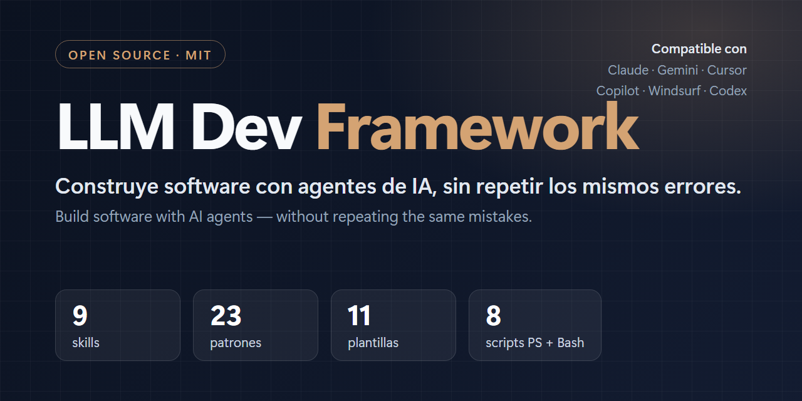

<p align="center">
  
</p>

<p align="center">
  <a href="https://github.com/Nashova/LLM-Dev-Framework/actions/workflows/ci.yml"></a>
  <a href="LICENSE"></a>
  
  
</p>

<p align="center"><a href="README.md">Español</a> · <b>English</b></p>

# LLM Dev Framework

> **An LLM that repeats the same mistake is not a model failure — it is evidence that the lesson was never written down where the AI would read it again at the moment it matters.**

A universal, reusable framework to build, audit and maintain software **with** language models (Claude, Gemini, Antigravity, Cursor, Copilot, Windsurf, ChatGPT or any AI agent) as active technical collaborators — removing the trial-and-error loop.

It is not a library or a code generator: it is a set of **documents, templates, skills and scripts** that you copy into your project so that any LLM working on it finds the rules, the context and the tools exactly where it will read them when they matter.

> **Language note.** The documentation (guides, patterns, skills, templates and case studies) is written in **Spanish**; this README is the English entry point. The scripts are language-neutral. Translations and corrections are welcome — see [`CONTRIBUTING.md`](CONTRIBUTING.md).

## Contents

- [What is inside](#what-is-inside)
- [Quick start](#quick-start)
- [Skills: protocols that trigger themselves](#skills-protocols-that-trigger-themselves)
- [Architecture patterns](#architecture-patterns)
- [Does it work with a local or small model?](#does-it-work-with-a-local-or-small-model)
- [Where this comes from](#where-this-comes-from)
- [How to consume this repo](#how-to-consume-this-repo)
- [Scope, requirements and quality](#scope-requirements-and-quality)
- [Contributing](#contributing) · [License](#license)

## What is inside

| Component | What it is | Where |
|---|---|---|
| **Master guide** | The single source of truth every AI reads: rules, workflow and definition of done. | [`AGENT_GUIDE.md`](AGENT_GUIDE.md) |
| **9 skills** | Protocols that activate themselves when needed (verify before claiming, risky-change gate, pre-publication audit…). | [`skills/`](skills/README.md) |
| **23 patterns** | Architecture and human-AI collaboration patterns, each born from a real incident. | [`docs/03_architecture_patterns/`](docs/03_architecture_patterns) |
| **11 templates** | Ready-to-copy governance: knowledge base, architecture, change safety, postmortem, SOP, requirements, project plan… | [`docs/02_governance_templates/`](docs/02_governance_templates/README.md) |
| **7 principles** | Philosophy of human-AI collaboration, persistent memory and documentation freshness. | [`docs/00_philosophy/`](docs/00_philosophy) |
| **8 scripts** | Automated operations, each in **PowerShell and Bash**: project map, anti-drift validator, multi-AI connector, skills installer, safety check, ship, PR client and encoding cleanup. | [`scripts/`](scripts/README.md) |
| **3 case studies** | Real systems, published **anonymized**: the patterns come from them. | [`examples/`](examples) |

## Quick start

Run every command **from the root of your project**, not from the framework repo. `$FW` is the path where you cloned it.

```bash
git clone https://github.com/Nashova/LLM-Dev-Framework.git
FW="$PWD/LLM-Dev-Framework"

cd /path/to/your-project
cp "$FW/AGENT_GUIDE.md" .                                       # 1. adapt the <!-- TODO --> sections to your project
bash "$FW/scripts/bootstrap-ai.sh"                              #    generates CLAUDE.md, GEMINI.md, AGENTS.md, .cursorrules…
bash "$FW/scripts/install-skills.sh" --target . --tool claude   # 4. install the skills (or cursor, copilot, windsurf…)
```

On Windows every script has a `.ps1` twin: `powershell -File $FW\scripts\bootstrap-ai.ps1`.

The full step-by-step guide (documentation templates, script configuration, continuous verification) is in [`docs/01_bootstrap/new-project-checklist.md`](docs/01_bootstrap/new-project-checklist.md) and, per AI tool, in [`docs/01_bootstrap/llm-setup-guide.md`](docs/01_bootstrap/llm-setup-guide.md).

## Skills: protocols that trigger themselves

A rule written in a 400-line document is read once and forgotten. A **skill** with the right description activates exactly when it is needed. They are written once and an installer translates them to the native format of each tool:

| Skill | Triggers when… |
|---|---|
| [`verify-before-claiming`](skills/verify-before-claiming/SKILL.md) | you are about to claim something exists, does not exist or is in use: it checks against the real state (it targets an LLM's most expensive error — asserting something false with confidence). |
| [`safe-change-gate`](skills/safe-change-gate/SKILL.md) | you are about to make a risky change: migrations, permissions, CI/CD, protected files or scripts against a shared environment. |
| [`project-onboarding`](skills/project-onboarding/SKILL.md) | a session starts or the context changes: it gets the real state of the project. |
| [`doc-drift-check`](skills/doc-drift-check/SKILL.md) | before a PR or release, or after a refactor: it detects documentation that no longer tells the truth. |
| [`incident-capture`](skills/incident-capture/SKILL.md) | the root cause of a real incident has been found: it records it in the catalog so it does not happen again. |
| [`requirements-intake`](skills/requirements-intake/SKILL.md) | an unspecified business request arrives: it turns it into a formal, traceable requirement. |
| [`ship-changes`](skills/ship-changes/SKILL.md) | someone asks to commit, push, deploy or open the PR: it uses the project's pipeline instead of raw git. |
| [`small-model-handoff`](skills/small-model-handoff/SKILL.md) | you work with a small or local model: it prepares the task so it can be executed reliably. |
| [`pre-publication-audit`](skills/pre-publication-audit/SKILL.md) | a repo is about to go public or be handed to a third party: it audits secrets, customer data and history. |

```bash
bash scripts/install-skills.sh --list                                 # see what is available
bash scripts/install-skills.sh --target /my-project --tool claude     # or cursor, copilot, windsurf...
bash scripts/install-skills.sh --target /my-project --tool all        # if the team uses several tools
```

## Architecture patterns

Each pattern was born from a real incident and declares its scope in its first line.

| Area | Patterns |
|---|---|
| **Security and change control** | [`secrets-management`](docs/03_architecture_patterns/secrets-management.md) · [`destructive-action-confirmation`](docs/03_architecture_patterns/destructive-action-confirmation.md) · [`rbac-cascade`](docs/03_architecture_patterns/rbac-cascade.md) · [`audit-logging`](docs/03_architecture_patterns/audit-logging.md) · [`sandbox-mode-safety`](docs/03_architecture_patterns/sandbox-mode-safety.md) · [`incident-log-pattern`](docs/03_architecture_patterns/incident-log-pattern.md) |
| **Documentation and memory for AIs** | [`ai-knowledge-base-verification`](docs/03_architecture_patterns/ai-knowledge-base-verification.md) · [`verify-external-assumptions`](docs/03_architecture_patterns/verify-external-assumptions.md) · [`universal-multi-ai-setup`](docs/03_architecture_patterns/universal-multi-ai-setup.md) · [`skills-and-triggers`](docs/03_architecture_patterns/skills-and-triggers.md) · [`resumable-agent-workflows`](docs/03_architecture_patterns/resumable-agent-workflows.md) · [`requirements-to-task-pipeline`](docs/03_architecture_patterns/requirements-to-task-pipeline.md) · [`encoding-and-text-hygiene`](docs/03_architecture_patterns/encoding-and-text-hygiene.md) |
| **Data, infrastructure and deployment** | [`tolerant-migrations`](docs/03_architecture_patterns/tolerant-migrations.md) · [`branch-per-environment-config`](docs/03_architecture_patterns/branch-per-environment-config.md) · [`proxy-dns-cache-invalidation`](docs/03_architecture_patterns/proxy-dns-cache-invalidation.md) · [`multi-repo-orchestrator`](docs/03_architecture_patterns/multi-repo-orchestrator.md) · [`orm-serialization-safety`](docs/03_architecture_patterns/orm-serialization-safety.md) · [`batch-file-validation`](docs/03_architecture_patterns/batch-file-validation.md) |
| **Frontend** (only if you have an SPA) | [`zero-routing-frontend`](docs/03_architecture_patterns/zero-routing-frontend.md) · [`strict-ui-layout-boundaries`](docs/03_architecture_patterns/strict-ui-layout-boundaries.md) · [`standardized-loading-framework`](docs/03_architecture_patterns/standardized-loading-framework.md) · [`centralized-api-interceptors`](docs/03_architecture_patterns/centralized-api-interceptors.md) |

## Does it work with a local or small model?

Yes, without lowering the quality of the deliverable. The framework has three kinds of component and **only one degrades with model size**: the **scripts** are deterministic (a 7B model running `safety-check` gets the exact same result as a frontier model), the **templates** barely degrade, and **judgment** degrades a lot.

The strategy is therefore to move work from the model into structure: one step per turn with a completion criterion that a command can verify, minimal targeted context, templates instead of free-form writing, and external verification after each step. The full guide — what to expect from a 7B / 14B / 30B model, the degradation ladder and what to **never** delegate — is in [`docs/00_philosophy/working-with-small-models.md`](docs/00_philosophy/working-with-small-models.md).

The recommended setup is hybrid: a large model decomposes and reviews, a local model executes, and the scripts verify. The `small-model-handoff` skill produces that plan in the right format.

## Where this comes from

It was distilled from real experience in three systems of very different scale, stack and problem space. The cases are published **anonymized** — no system, customer, sector, infrastructure or internal identifiers — because the only reusable part is the mechanism of the incident and the rule that came out of it.

1. **Case A — internal admin console** (Python backend + SPA on containers behind a reverse proxy): deployment-safety patterns, incident catalog, granular RBAC and scripts with no external-CLI dependency. See [`examples/case-study-admin-console.md`](examples/case-study-admin-console.md).
2. **Case B — multi-repo ecosystem in a regulated sector** (MVC backend + SPA + two reporting engines, half a dozen independent repos): the two-level verifiable knowledge base, per-environment configuration, the instant mental map, persistent memory across sessions and the formal requirements-to-tasks pipeline. See [`examples/case-study-multi-repo-ecosystem.md`](examples/case-study-multi-repo-ecosystem.md).
3. **Case C — batch validation and routing engine** (console app on a compiled runtime, with concurrency between instances): strict sandbox isolation, verification of external assumptions, batch validation with optimistic locking and multi-agent synchronization. See [`examples/case-study-batch-engine.md`](examples/case-study-batch-engine.md).

A fourth case, [`examples/case-study-self-audit.md`](examples/case-study-self-audit.md), documents how the framework audited itself.

## How to consume this repo

The framework is **not installed and not added as a dependency**. There are three valid ways to use it:

| Mode | How | When it fits |
|---|---|---|
| **Copy** (recommended) | Clone this repo separately and copy `AGENT_GUIDE.md`, `scripts/` and `docs/02_governance_templates/` into your project. Your copy evolves with your project. | The normal case. Each project adapts the rules to its reality. |
| **Submodule** | `git submodule add <url> .llm-framework` and reference the patterns without copying them. | You want framework updates without re-copying. |
| **Reference** | You copy nothing; you read it and write your own rules inspired by the patterns. | Small or exploratory projects. |

## Scope, requirements and quality

**Scope.** The framework was distilled from web and console projects, and some patterns are **conditional on the application type**. The frontend patterns (`zero-routing-frontend`, `strict-ui-layout-boundaries`, `standardized-loading-framework`, `centralized-api-interceptors`) only apply if your project has an SPA. If it is a CLI, a backend service, a library or a mobile app, ignore them — and delete the matching items from your `AGENT_GUIDE.md` checklist instead of leaving them as rules that do not apply. Each pattern declares its scope in its first line.

**Requirements.**

- **PowerShell 5.1+** (Windows) or **Bash 4+** (Linux/macOS/WSL) — every script exists in both flavors.
- **git** on the `PATH`.
- For the `.sh` scripts: `curl` and `python3` (to parse git-provider API JSON without depending on `jq`).
- Optional: the `gh` CLI. Without it, `git-provider-pr` uses the REST API directly.

**Quality.** The framework applies to itself what it preaches: [continuous integration](.github/workflows/ci.yml) runs on every change its own `safety-check` and its anti-drift validator for `file:line` citations (in Bash and in Windows PowerShell 5.1), requires every script to have its `.ps1`/`.sh` twin, requires `.ps1` files to be pure ASCII and checks that no relative documentation link is broken.

## Contributing

Issues and pull requests are welcome. The most valuable contribution is a **pattern with evidence**: a real incident, its root cause and the rule that prevents it. Read [`CONTRIBUTING.md`](CONTRIBUTING.md) first; for vulnerabilities, see [`SECURITY.md`](SECURITY.md).

## License

MIT — see [`LICENSE`](LICENSE).
