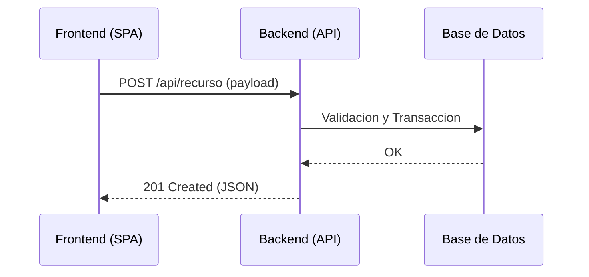

# PROY-YYYY-NNN: [Titulo del Proyecto Tecnico]

| Metadato | Valor |
|---|---|
| **ID Proyecto** | PROY-YYYY-NNN |
| **Requerimientos Asociados** | REQ-YYYY-NNN |
| **Fecha de Diseno** | YYYY-MM-DD |
| **Arquitecto / Lead** | [Nombre] |
| **Estado** | [Diseno / En Desarrollo / Staging / Desplegado] |

---

## 1. Resumen Tecnico y Arquitectura
Resumen de la estrategia tecnica para resolver el requerimiento, tecnologias involucradas y patrones de diseno a aplicar.

## 2. Diagrama de Flujo / Secuencia

## 3. Desglose de Tareas (Task Breakdown)

### Fase 1: Base de Datos y Modelos
- [ ] **T01**: Crear migracion `db/migrate/...` para nuevos campos.
- [ ] **T02**: Agregar validaciones y callbacks en modelo `app/models/...`.

### Fase 2: Backend & Endpoints
- [ ] **T03**: Implementar controlador y rutas en `app/controllers/...`.
- [ ] **T04**: Implementar servicio de negocio `app/services/...`.

### Fase 3: Frontend & UI/UX
- [ ] **T05**: Crear componente de interfaz y vincular a Store.
- [ ] **T06**: Manejo de estados de carga y feedback de errores.

### Fase 4: Pruebas y Despliegue
- [ ] **T07**: Specs unitarios y de integracion.
- [ ] **T08**: Validacion de documentacion (`Validate-KnowledgeBase`).

## 4. Matriz de Dependencias y Riesgos
| Dependencia | Impacto | Mitigacion |
|---|---|---|
| Sistema Externo X | Alto | Mock de desarrollo y fallback asincrono |
