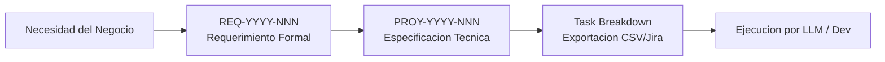

# Patron: Pipeline de Requerimientos a Tareas y Exportacion a Gestores

## El Problema
El trabajo solicitado por clientes y stakeholders suele llegar de forma ambigua ("optimizar la pantalla", "agregar exportacion"). Si el LLM empieza a programar directamente sobre peticiones ambiguas, produce codigo que no coincide con las expectativas del negocio o rompe contratos no declarados.

## El Pipeline de 4 Pasos

### 1. Captura del Requerimiento (`REQ-YYYY-NNN`)
- Define el **problema de negocio** sin atarse a la solucion tecnica.
- Establece criterios de aceptacion (Given-When-Then).
- Registra preguntas abiertas y riesgos conocidos.

### 2. Especificacion Tecnica (`PROY-YYYY-NNN`)
- Define arquitectura, modelos afectados, endpoints y contratos JSON.
- Resuelve las preguntas abiertas antes de tocar codigo.
- Divide la solucion en fases logicas (BD -> Backend -> Frontend -> QA).

### 3. Desglose y Exportacion de Tareas
- Las tareas deben ser **autocontenidas**: quien lea la tarea en ClickUp, Jira o Asana debe tener todo el contexto necesario sin depender de enlaces internos inaccesibles para usuarios no desarrolladores.
- Formato CSV estructurado para importacion directa en 1 clic.

### 4. Ejecucion Guiada y Cierre
- El LLM ejecuta tarea por tarea, marcando checkboxes y corriendo validaciones antes de pasar a la siguiente fase.
